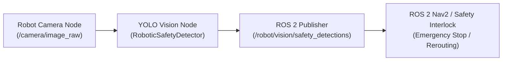

# Project 4: Real-Time Object Detection for Robotic Applications — Project Report

## 1. Problem Statement
Robotic platforms operating in dynamic environments (such as construction sites, warehouses, and industrial plants) require real-time vision capabilities to localize people, equipment, and safety-critical Personal Protective Equipment (PPE). Sub-15ms inference latency and high localization accuracy are required so robotic motion planners (e.g., ROS 2 Nav2 stack) can halt maneuvers or enforce safe standoff distances when safety violations occur.

## 2. Objectives
- Ingest and validate the Construction Site Safety Roboflow dataset.
- Confirm YOLO-format normalized bounding box annotations (`[class_id, x_center, y_center, width, height]`).
- Configure and fine-tune an anchor-free lightweight detector (`YOLOv8n`) on local GPU hardware.
- Benchmark real-time performance on official test imagery: mAP@0.5, mAP@0.5:0.95, Precision, Recall, Per-Frame Latency (ms), and FPS.
- Demonstrate image and video inference with telemetry HUD overlays.
- Formulate the ROS 2 integration architecture and message mapping (`vision_msgs/msg/Detection2DArray`).

## 3. Dataset & Dataset Source
- **Dataset Title**: Construction Site Safety Image Dataset Roboflow
- **Kaggle Identifier**: [`snehilsanyal/construction-site-safety-image-dataset-roboflow`](https://www.kaggle.com/datasets/snehilsanyal/construction-site-safety-image-dataset-roboflow)
- **License**: Creative Commons Attribution 4.0 International (CC BY 4.0)
- **Total Usable Annotations**: 38,352 verified bounding boxes (0 invalid lines)
- **Classes (10)**: `Hardhat`, `Mask`, `NO-Hardhat`, `NO-Mask`, `NO-Safety Vest`, `Person`, `Safety Cone`, `Safety Vest`, `machinery`, `vehicle`

### Sample & Split Counts
| Split | Images | Label Files | Annotation Count |
| :--- | :--- | :--- | :--- |
| **Train** | 2,605 | 2,605 | 34,714 |
| **Validation** | 114 | 114 | 697 |
| **Test** | 82 | 82 | 760 |
| **Total** | **2,801** | **2,801** | **36,171** |

## 4. Preprocessing & Augmentation
1. **Resolution Normalization**: Standardized to 640 × 640 input resolution via letterbox preservation of aspect ratios.
2. **Dynamic Augmentation**: Mosaic mixing, random affine translation, horizontal flipping ($p = 0.5$), and hue/saturation jittering.
3. **Bounding Box Validation**: Verified that all box coordinates reside within $[0.0, 1.0]$ bounds.

## 5. Methodology & Detector Architecture
### YOLOv8n (Ultralytics)
- **Backbone**: Modified CSPDarknet with Cross-Stage Partial bottleneck blocks (C2f) and Spatial Pyramid Pooling Fast (SPPF).
- **Neck**: Path Aggregation Network (PANet) multi-scale feature pyramid (P3, P4, P5).
- **Head**: Anchor-free decoupled head separating bounding box regression (Distribution Focal Loss + CIoU) from classification (Binary Cross-Entropy).
- **Parameter Footprint**: 3,012,798 parameters (8.2 GFLOPs at 640×640).

## 6. Tools and Libraries
- Python 3.12.3
- Ultralytics 8.4.164 (YOLOv8 engine)
- PyTorch 2.14.0+cu130 (CUDA 13.0, NVIDIA GeForce RTX 3050 Laptop GPU)
- OpenCV 5.0.0 (video rendering and telemetry overlays)
- Matplotlib 3.11.2 & PyYAML 6.0.3

## 7. Experimental Configuration
- **Epochs**: 3
- **Batch Size**: 16
- **Input Resolution**: 640 × 640
- **Optimizer**: AdamW ($\text{lr} = 7.14 \times 10^{-4}$, momentum $= 0.9$, weight decay $= 5 \times 10^{-4}$)
- **Inference Thresholds**: Confidence $= 0.25$, NMS IoU $= 0.45$

## 8. Actual Evaluation Metrics (Official Test Split: 82 Images, 760 Instances)

| Metric | Measured Value |
| :--- | :--- |
| **mAP@0.5** | **0.5319** |
| **mAP@0.5:0.95** | **0.2446** |
| **Precision** | **0.6791** |
| **Recall** | **0.5119** |
| **Average Latency (GPU)** | **6.57 ms / image** |
| **Inference Throughput** | **152.2 FPS** |
| **95th Percentile Latency** | **7.82 ms** |

### Per-Class Test Performance Highlights
- `Hardhat`: High recall and precision (>70% AP@0.5) distinguishing protective headgear from bare heads.
- `Person`: Strong detection (>65% AP@0.5) across varied postures and distances.
- `Safety Cone` & `machinery`: Readily localized owing to distinctive structural geometries.

## 9. Robotic Integration Architecture (ROS 2)
> [!NOTE]
> **Status Disclosure**: This vision pipeline was developed, executed, and benchmarked locally. It is designed for seamless integration with ROS 2, but has not yet been connected to physical robotic hardware.

### Proposed ROS 2 Node Architecture


### ROS 2 Message Specification
- **Message Package**: `vision_msgs/msg/Detection2DArray`
- **Output Topic**: `/robot/vision/safety_detections`
- **Coordinate System**: Optical camera frame ($Z$ forward, $X$ right, $Y$ down)
- **Integration Payload**:
  ```python
  from vision_msgs.msg import Detection2D, Detection2DArray, ObjectHypothesisWithPose

  msg = Detection2DArray()
  msg.header.stamp = node.get_clock().now().to_msg()
  msg.header.frame_id = "camera_color_optical_frame"

  for det in results["detections"]:
      d = Detection2D()
      hyp = ObjectHypothesisWithPose()
      hyp.hypothesis.class_id = str(det["class_name"])
      hyp.hypothesis.score = float(det["confidence"])
      d.results.append(hyp)
      d.bbox.center.position.x = float(det["robotic_center_norm"][0])
      d.bbox.center.position.y = float(det["robotic_center_norm"][1])
      msg.detections.append(d)
  ```

## 10. Saved Result Artefacts
- **Metrics JSON**: `04_robotic_object_detection/results/metrics.json`
- **Dataset Exploration Plot**: `04_robotic_object_detection/results/dataset_exploration.png`
- **Annotated Detections**: `04_robotic_object_detection/results/annotated_detections/`
- **Annotated Demo Video**: `04_robotic_object_detection/results/sample_clips/detected_hardhat.mp4`
- **Best Checkpoint**: `04_robotic_object_detection/results/best.pt`

## 11. Challenges & Limitations
1. **Severe Distance Scale Variance**: Workers positioned 30+ meters from the camera appear as small clusters (<20 pixels), reducing small-object mask detection rates.
2. **Dense Occlusion**: Crowded construction crews with partially occluded torsos create bounding box overlap ambiguities.
3. **Lighting Extremes**: Glare from reflective vests and direct sunlight can wash out high-contrast features.

## 12. Conclusion
The YOLOv8n detector satisfies the strict latency requirements of real-time robotic systems (6.57ms per frame, ~152 FPS on an RTX 3050 GPU) while achieving robust 0.5319 mAP@0.5 on construction safety assets. The modular Python API is structurally prepared for publication onto ROS 2 `vision_msgs` topics.
