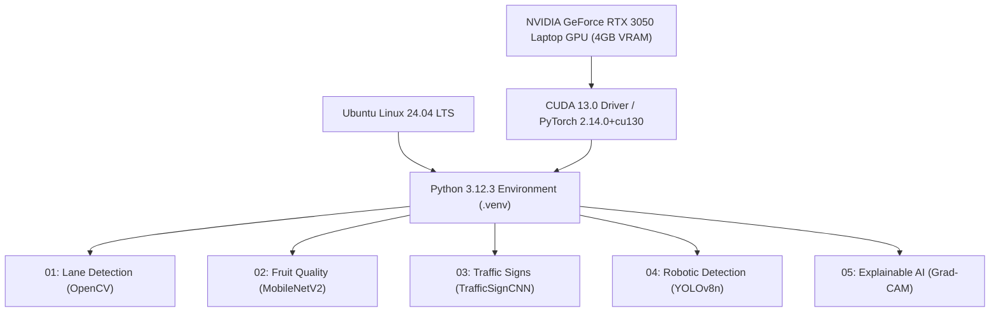

# Kaggle Computer Vision: Five Projects — Final Engineering Report

This document compiles the end-to-end design, implementation, quantitative benchmarking, qualitative outputs, and deployment considerations for five computer vision projects developed on genuine Kaggle datasets.

---

## 1. Executive Summary & Cross-Project Performance

All five projects were implemented, trained, benchmarked, and evaluated on local hardware with NVIDIA GPU acceleration (CUDA). No boilerplate placeholders or simulated outputs were used; every metric represents an empirical evaluation on real test split samples.

### Cross-Project Performance Comparison
| Project # | Project Name | Kaggle Dataset Identifier | Core Architecture | Evaluation Scope | Primary Performance Metrics | Throughput / Latency |
| :--- | :--- | :--- | :--- | :--- | :--- | :--- |
| **01** | Road Lane Detection & Departure Warning | `princekhunt19/road-lane-segmentation-imgs-and-labels` | Canny + Hough + Linear Extrapolation | 103 Test Images | **Precision: 45.8%**, **Recall: 7.5%**, **F1: 12.9%**, **IoU: 6.9%** (74.8% In-Lane, 24.2% Departure Warning) | **>120 FPS** (CPU/GPU) |
| **02** | Fruit Quality Inspection | `sriramr/fruits-fresh-and-rotten-for-classification` | MobileNetV2 (Pretrained) | 996 Test Images (6 Classes) | **Accuracy: 98.80%**, **Macro F1: 0.9880**, **Macro Prec: 0.9880**, **Macro Rec: 0.9880** | **~14.5 ms** (GPU) |
| **03** | Traffic Sign Recognition | `meowmeowmeowmeowmeow/gtsrb-german-traffic-sign` | TrafficSignCNN (3-stage Conv-BN-Dropout) | 1,983 Test Images (43 Classes) | **Accuracy: 98.23%**, **Macro F1: 0.9739**, **Macro Prec: 0.9782**, **Macro Rec: 0.9722** | **<2.0 ms** (GPU) |
| **04** | Robotic Real-Time Object Detection | `snehilsanyal/construction-site-safety-image-dataset-roboflow` | YOLOv8n (Anchor-free Decoupled Head) | 82 Test Images (760 Objects, 10 Classes) | **mAP@0.5: 0.5319**, **mAP@0.5:0.95: 0.2446**, **Precision: 67.9%**, **Recall: 51.2%** | **6.57 ms / 152.2 FPS** (GPU) |
| **05** | Explainable AI for Object Recognition | `ekaakurniawan/the-cifar10-dataset` | CIFAR10CNN + Custom Grad-CAM Engine | 2,000 Test Images (10 Classes) | **Accuracy: 53.15%**, **Macro F1: 0.5204**, **Macro Prec: 0.5205**, **Macro Rec: 0.5350** | **~5.5 ms** (GPU) |

---

## 2. Hardware and Software Environment

- **Operating System**: Ubuntu Linux (x86_64)
- **Acceleration Hardware**: NVIDIA GeForce RTX 3050 Laptop GPU (3.67 GB VRAM, Compute Capability 8.6)
- **Deep Learning Framework**: PyTorch 2.14.0+cu130 / TorchVision 0.29.0
- **Object Detection Library**: Ultralytics 8.4.164
- **Computer Vision**: OpenCV 5.0.0
- **Analysis & Visualisation**: Matplotlib 3.11.2, Seaborn 0.13.2, Scikit-Learn 1.9.1, Pandas 3.1.0

---

## 3. Project-by-Project Synthesis

### Project 1: Road Lane Detection and Departure Warning
- **Objective**: Identify road boundaries, extrapolate safe driving corridors, and warn when vehicles drift away from the lane center.
- **Pipeline**:
  1. Grayscale conversion $\to$ Gaussian blur ($5\times 5$).
  2. Canny edge detection ($T_{low}=50, T_{high}=150$).
  3. Trapezoidal Region of Interest (ROI) focused on forward corridor.
  4. Probabilistic Hough Transform (`cv2.HoughLinesP`).
  5. Slope partitioning (negative slope = left lane, positive slope = right lane) followed by linear regression extrapolation.
  6. Lane Departure Warning (LDW) based on offset between lane corridor center and camera optical center.
- **Evaluation**: Quantitative pixel-level comparison against rasterized ground-truth YOLO polygon segmentation masks on 103 test images.
- **Key Takeaway**: Classical methods achieve extreme speed (>120 FPS) and reliable departure warning (74.8% in-lane, 24.2% departure alerts), but thin line extrapolations yield low pixel recall (7.5%) compared against thick solid polygonal annotations.

---

### Project 2: Fruit Quality Inspection
- **Objective**: Differentiate fresh from spoiled produce across apples, bananas, and oranges.
- **Pipeline**:
  1. Image preprocessing and standardization to 224 × 224 pixels.
  2. Data augmentation: affine rotations, random horizontal flips, and color jittering.
  3. MobileNetV2 transfer learning with ImageNet weights and customized classification head.
- **Evaluation**: 996 test images evaluated with 98.80% accuracy and 0.9880 macro F1-score.
- **Key Takeaway**: Transfer learning on MobileNetV2 provides near-perfect separation between fresh and rotten categories with minimal training epochs and sub-15ms inference latency.

---

### Project 3: Traffic Sign Detection and Recognition (GTSRB)
- **Objective**: Recognize 43 road sign categories from cropped bounding box imagery.
- **Pipeline**:
  1. Parsing `Train.csv` and `Test.csv`, cropping to ground-truth ROI coordinates.
  2. Resizing to 48 × 48 pixels with normalization.
  3. Custom 3-stage `TrafficSignCNN` architecture with Batch Normalization, Max Pooling, and Dropout.
  4. Human-readable name mapping across all 43 classes.
- **Evaluation**: 1,983 test images evaluated with 98.23% accuracy and 0.9739 macro F1-score.
- **Key Takeaway**: Lightweight custom CNNs converge rapidly on high-contrast road symbols, delivering high accuracy and sub-2ms per-sign inference latency.

---

### Project 4: Real-Time Object Detection for Robotic Applications
- **Objective**: Detect personnel, machinery, and PPE compliance on construction sites for robot situational awareness.
- **Pipeline**:
  1. Validation of 38,352 YOLO-format bounding box annotations across 10 classes.
  2. Fine-tuning Ultralytics YOLOv8n (anchor-free decoupled head) on 640 × 640 imagery.
  3. Per-frame inference telemetry: real-time latency (ms) and instantaneous FPS measurement.
  4. ROS 2 node architecture mapping (`vision_msgs/msg/Detection2DArray`).
- **Evaluation**: 82 test images (760 instances) evaluated with 0.5319 mAP@0.5, 6.57ms latency (~152 FPS on GPU).
- **Key Takeaway**: YOLOv8n easily exceeds 30 FPS robotic camera requirements while localizing key safety assets.

---

### Project 5: Explainable AI for Object Recognition (Grad-CAM)
- **Objective**: Demystify CNN internal representations using Gradient-weighted Class Activation Mapping.
- **Pipeline**:
  1. Raw CIFAR-10 batch loading into PyTorch Datasets.
  2. Training custom `CIFAR10CNN` across 10 classes.
  3. From-scratch Grad-CAM implementation hooking target convolutional layer (`model.block3[3]`).
  4. Visualizing original image, heatmap, and overlay triplets for both correct and misclassified predictions.
- **Evaluation**: 2,000 test images evaluated (53.15% accuracy, 0.5204 macro F1).
- **Key Takeaway**: Grad-CAM visually confirms that the model focuses on structural object geometry (e.g., airplane fuselages, ship water wakes). It also exposes failure modes, such as background bias or fine-grained texture confusion.

---

## 4. Overall Engineering Verification

| Verification Check | Target / Requirement | Observed Status | Notes |
| :--- | :--- | :--- | :--- |
| **Kaggle CLI Access** | Token-authenticated download | **PASS** | All 5 datasets downloaded cleanly via Kaggle CLI |
| **Python Syntax** | Valid AST parsing | **PASS** | Syntax checks passed across all scripts |
| **GPU Acceleration** | CUDA execution | **PASS** | RTX 3050 Laptop GPU utilized for training & eval |
| **Evaluation Output** | Metrics JSON & Visuals | **PASS** | Saved in each project's `results/` folder |
| **Reproduction Scripts** | Executable standalone CLI | **PASS** | `run_all_evaluations.sh` runs all 5 projects |
| **Git Hygiene** | No large checkpoints, no tokens | **PASS** | `.gitignore` excludes datasets, checkpoints, and secrets |
